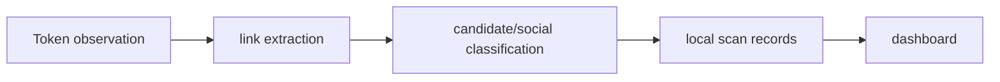

# New Token Discovery Dashboard

**Read-only token discovery, social-link classification and scheduled rechecks.**

  [](LICENSE)

[Overview](#overview) · [Quickstart](#quickstart) · [Example](#example) · [Validation](#validation) · [Documentation](#documentation)

## Overview

A read-only token-discovery toolkit with social-link classification, recheck policies and a local dashboard.

**Stack:** JavaScript · Node.js · native fetch · HTML/CSS dashboard · node:test

## Discovery keeps provisional results visible

| Component | Behavior |
| --- | --- |
| Watch | Source watchers produce new-token observations. |
| Classify | Link/candidate classifiers expose explainable categories. |
| Recheck | Policies schedule later checks for provisional social results. |

## Processing path



## Quickstart

```console
node --test test/game-classifier.test.js test/social-links.test.js test/twitter-x-check.test.js test/x-check-policy.test.js test/x-recheck-schedule.test.js
```

The commands above install prerequisites or run the specified offline checks. Live collection, cloud operations, messaging and trading are separate operational steps when present.

## Example

**Inspect the workflow**

Follow a token observation into extracted social links, classification and a local record. Treat an inconclusive social result as provisional and inspect the recheck policy. Source watchers, historical backfills and the dashboard server are separate package scripts; the quickstart runs only the named offline suites.

## Configuration and storage

Node.js 22+ with native fetch. JSON/JSONL records feed the HTML/CSS dashboard. [.env.example](.env.example) documents social API configuration. Live watcher/backfill commands may consume provider quotas.

## Repository guide

| Location | Responsibility |
| --- | --- |
| [src/watch-new-tokens.js](src/watch-new-tokens.js) | Token watcher |
| [src/game-classifier.js](src/game-classifier.js) | Candidate classifier |
| [src/recheck-x-records.js](src/recheck-x-records.js) | Social rechecks |
| [dashboard](dashboard) | Local interface |

## Validation

These checks use offline fixtures or controlled backends.

## Scope and operational boundaries

Classifier fixtures do not validate every live source. Current source authorization, API limits and dashboard data need separate configuration. This repository provides discovery/classification workflows.

## Documentation

- The repository guide above links directly to the implementation and configuration files.

## License and attribution

Project-authored source code is licensed under the [MIT License](LICENSE). Third-party components and datasets retain their respective rights and licenses.
